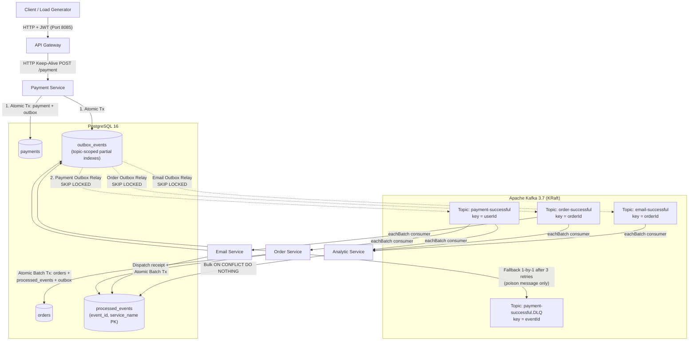
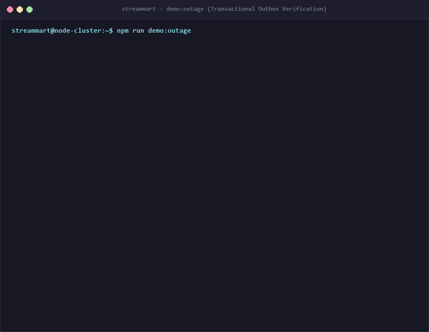

# StreamMart: Event-Driven E-Commerce Microservices

[](https://github.com/vpn-cli/streammart/actions/workflows/ci.yml)

> Resilient, high-throughput event-driven e-commerce microservices platform demonstrating zero-data-loss checkout persistence via the Transactional Outbox pattern and idempotent Kafka stream processing.

<div align="center">
  
  
  
  
  
  
</div>

## Overview

StreamMart is an event-driven e-commerce microservices system built with Node.js, Apache Kafka (KRaft), PostgreSQL 16, Drizzle ORM, and Docker Compose. It demonstrates reliable asynchronous event processing using the **Transactional Outbox** pattern (`SELECT ... FOR UPDATE SKIP LOCKED`), **idempotent batch consumers** (`eachBatch` with `processed_events`), **per-message poison-pill fallback to a Dead Letter Queue (DLQ)**, deterministic partition keys, and distributed event lineage (`eventId`, `correlationId`, `causationId`).

---

## Architecture



### Core Reliability Patterns

1. **Transactional Outbox (`outbox_events`)**: `payment-service`, `order-service`, and `email-service` write business state and outgoing events in a single PostgreSQL transaction. Background relay workers claim rows with `SELECT ... FOR UPDATE SKIP LOCKED`, publish to Kafka, and mark `published = true`, while topic-scoped pruners clean up published rows older than `OUTBOX_RETENTION_HOURS`.
2. **Idempotent Consumers (`processed_events`)**: `order-service`, `email-service`, and `analytic-service` deduplicate incoming events on `(event_id, service_name)`. Redeliveries after a crash before Kafka offset commit skip already-processed events cleanly (zero duplicate orders).
3. **Poison-Message Fallback in `eachBatch`**: If a batch transaction in `order-service` fails, the transaction rolls back cleanly and `order-service` falls back to processing that batch one message at a time in offset order. Valid messages still commit; after 3 retries, only the failing message is sent to `payment-successful.DLQ` and the consumer continues without getting stuck.
4. **Split Health Checks (`payment-service`)**: `GET /health` reports process liveness (200 even during a Kafka outage so checkouts keep succeeding into PostgreSQL), while `GET /relay-status` reports Kafka relay and outbox pruner health (503 when disconnected from Kafka).
5. **Strict Secret Hygiene & Zero-Fallback Gateway**: `api-gateway/config.js` enforces that `JWT_SECRET` is defined and at least 32 characters long at startup; missing or short secrets fail immediately with a clear error. Both token issuance (`index.js`) and token verification (`auth.middleware.js`) share this single config module without hardcoded fallback strings.

---

## Security & Secret Management

- **Centralized Validation (`api-gateway/config.js`)**: Fails fast on startup if `JWT_SECRET` is missing or shorter than 32 characters.
- **No Hardcoded Fallback Secrets**: `docker-compose.yml` injects `JWT_SECRET=${JWT_SECRET}` without fallbacks so unconfigured container startups fail visibly instead of running on insecure defaults.
- **Automatic Local Secret Generation**: `node scripts/start-stack.js` detects if `JWT_SECRET` is missing from the local gitignored `.env`, auto-generates a secure 32-byte hex secret (`crypto.randomBytes(32).toString('hex')`), writes it to `.env`, and logs notice.
- **Ephemeral CI Secrets**: GitHub Actions workflow dynamically generates a unique masked 32-byte secret per run (`openssl rand -hex 32`) for both unit tests and Docker Compose resilience tests.
- **Gated Demo Auth Endpoints**: `POST /api/auth/token` and `POST /api/auth/tokens/batch` are disabled (returning HTTP 404) unless `DEMO_AUTH=true` and `NODE_ENV !== "production"`.

---

## Verified Benchmarks (Full-Drain Results Only)

All numbers below come from clean, reset-database, full-drain runs with raw outputs stored in `benchmarks/raw/` and detailed methodology in [PHASE1-BENCHMARKS.md](PHASE1-BENCHMARKS.md).

**Host for every benchmark row below**: Single local laptop — AMD Ryzen 7 6800H (8 physical cores / 16 threads @ 3.20 GHz), 16 GB RAM, Windows 11 Home (64-bit), Docker Desktop (WSL2). All 7 Docker containers and the k6 load generator ran on the same machine.

### 1. Order Consumer Throughput & Lag (`baseline_consumer` vs `fix_a` vs `fix_b`)

| Configuration | Workload | Host | Accepted req/s (mean) | True Completed checkouts/s (mean) | Order Lag @ 30s (mean) | Catch-up to Lag 0 (mean) | p50 / p95 Latency (ms) |
| :--- | :--- | :--- | :---: | :---: | :---: | :---: | :---: |
| `baseline_consumer` (1 part, `order=eachMessage`) | 20 VUs, 30s k6, 1,000 JWTs, 3 runs, full order drain | Ryzen 7 6800H / 16 GB / WSL2 | 199.06 | 71.37 | 3,984 msgs | 57.57s | 41.49 / 104.31 |
| `baseline_consumer` (1 part, `order=eachMessage`) | 50 VUs, 30s k6, 1,000 JWTs, 3 runs, full order drain | Ryzen 7 6800H / 16 GB / WSL2 | 227.17 | 56.23 | 5,645 msgs | 96.11s | 135.36 / 350.41 |
| `baseline_consumer` (1 part, `order=eachMessage`) | 100 VUs, 30s k6, 1,000 JWTs, 3 runs, full order drain | Ryzen 7 6800H / 16 GB / WSL2 | 285.61 | 48.42 | 7,420 msgs | 154.33s | 245.14 / 496.65 |
| `fix_a` (6 parts, `order=eachMessage`, `concurrency=6`) | 20 VUs, 30s k6, 1,000 JWTs, 3 runs, full order drain | Ryzen 7 6800H / 16 GB / WSL2 | 220.04 | 152.24 | 2,142 msgs | 14.06s | 33.44 / 75.09 |
| `fix_a` (6 parts, `order=eachMessage`, `concurrency=6`) | 50 VUs, 30s k6, 1,000 JWTs, 3 runs, full order drain | Ryzen 7 6800H / 16 GB / WSL2 | 273.48 | 90.74 | 5,858 msgs | 63.70s | 111.33 / 218.66 |
| `fix_a` (6 parts, `order=eachMessage`, `concurrency=6`) | 100 VUs, 30s k6, 1,000 JWTs, 3 runs, full order drain | Ryzen 7 6800H / 16 GB / WSL2 | 340.17 | 87.88 | 7,912 msgs | 97.92s | 205.64 / 399.67 |
| `fix_b` (1 part, `order=eachBatch`) | 20 VUs, 30s k6, 1,000 JWTs, 3 runs, full order drain | Ryzen 7 6800H / 16 GB / WSL2 | 253.12 | 251.17 | 0 msgs | 0.24s | 21.77 / 55.91 |
| `fix_b` (1 part, `order=eachBatch`) | 50 VUs, 30s k6, 1,000 JWTs, 3 runs, full order drain | Ryzen 7 6800H / 16 GB / WSL2 | 372.13 | 368.92 | 0 msgs | 0.27s | 74.00 / 140.81 |
| `fix_b` (1 part, `order=eachBatch`) | 100 VUs, 30s k6, 1,000 JWTs, 3 runs, full order drain | Ryzen 7 6800H / 16 GB / WSL2 | 379.49 | 375.75 | 0 msgs | 0.31s | 178.47 / 374.79 |

### 2. Full-Pipeline Downstream Consumer Lag (`email-service` & `analytic-service` under `fix_b`)

| Configuration | Workload | Host | Accepted req/s (mean) | Order Lag @ 30s / Catch-up | Email Lag @ 30s / Catch-up | Analytic Lag @ 30s / Catch-up (3x events) |
| :--- | :--- | :--- | :---: | :---: | :---: | :---: |
| Before (`order=eachBatch`, `email=eachMessage`, `analytic=eachMessage`) | 50 VUs, 30s k6, 1,000 JWTs, 3 runs, full 3-service drain | Ryzen 7 6800H / 16 GB / WSL2 | 304.48 | 0 msgs / 0.00s | 6,242 msgs / 48.68s | 23,661 msgs / 112.34s |
| Before (`order=eachBatch`, `email=eachMessage`, `analytic=eachMessage`) | 100 VUs, 30s k6, 1,000 JWTs, 3 runs, full 3-service drain | Ryzen 7 6800H / 16 GB / WSL2 | 274.86 | 0 msgs / 0.00s | 5,050 msgs / 44.09s | 20,480 msgs / 97.15s |
| Final (`order=eachBatch`, `email=eachBatch`, `analytic=eachBatch`, batched relays) | 50 VUs, 30s k6, 1,000 JWTs, 3 runs, full 3-service drain | Ryzen 7 6800H / 16 GB / WSL2 | 264.53 | 0 msgs / 0.00s | 0 msgs / 0.00s | 0 msgs / 0.00s |
| Final (`order=eachBatch`, `email=eachBatch`, `analytic=eachBatch`, batched relays) | 100 VUs, 30s k6, 1,000 JWTs, 3 runs, full 3-service drain | Ryzen 7 6800H / 16 GB / WSL2 | 319.53 | 0 msgs / 0.00s | 0 msgs / 0.00s | 0 msgs / 0.00s |

### 3. Resilience & Fault-Tolerance Verification (Final Code)

| Test Script | Workload / Failure Mode | Host | Verified Raw Counts |
| :--- | :--- | :--- | :--- |
| `scripts/test-poison-batch.js` | 50-msg batch (49 valid + 1 `userId=null` DB error) + 1 follow-up msg | Ryzen 7 6800H / 16 GB / WSL2 | 49/49 orders created, 1 message in `payment-successful.DLQ`, follow-up #51 processed (1/1), Kafka lag = 0 |
| `scripts/test-mid-batch-crash.js` | 50-msg batch committed to DB, `SIGKILL` before offset commit, restart | Ryzen 7 6800H / 16 GB / WSL2 | Lag before kill = 50; after restart: 50/50 orders present, 0 duplicates, 50/50 outbox published, lag = 0 |
| `scripts/test-outbox-outage.js` | Stop Kafka, send 500 checkouts, restart Kafka + 2 `SKIP LOCKED` relays | Ryzen 7 6800H / 16 GB / WSL2 | 500/500 HTTP 200 in 2.21s (0 orders while down); after recovery: 500/500 orders in 31.1s, 0 lost, 0 duplicates |
| `scripts/test-order-crash-recovery.js` | Kill `order-service` after DB commit and before outbox publish | Ryzen 7 6800H / 16 GB / WSL2 | 1/1 order persisted, 0 duplicates, 1/1 `order-successful` published, 1/1 email processed |

---

## Limitations

- **Single-laptop benchmark host**: All 7 Docker containers (PostgreSQL, Kafka, API Gateway, and 4 microservices) plus the k6 load generator ran on one laptop (Ryzen 7 6800H, 16 GB RAM, Docker Desktop WSL2). Numbers reflect relative behavior under shared CPU/disk contention, not isolated multi-node production capacity.
- **Shared `outbox_events` table**: `payment-service`, `order-service`, and `email-service` share a single PostgreSQL database and `outbox_events` table, isolated logically by `topic`, per-topic partial indexes, and topic-scoped pruners. A full production microservice split would give each service its own database instance and outbox table.
- **25 ms relay busy pause (`RELAY_BUSY_PAUSE_MS=25`) is an observed effect**: Early comparisons between 0 ms and 25 ms were confounded by environment drift and unforwarded env vars; no isolated event-loop lag or PostgreSQL lock-wait experiment proved 25 ms as a causal mechanism. Under verified `RELAY_BATCH_SEND=true` + `RELAY_BUSY_PAUSE_MS=25`, batched sends do not starve checkout ingress, and this setting is documented strictly as an observed working parameter.
- **`DEMO_AUTH` token endpoint is for demos and local testing only**: `POST /api/auth/token` and `POST /api/auth/tokens/batch` on `api-gateway` mint unsigned-passwordless demo JWTs for local tests, benchmarks, and demos. They are explicitly gated off (HTTP 404) whenever `NODE_ENV=production` or `DEMO_AUTH !== "true"`, and must never be enabled in production.

---

## Technology Stack

- **API Gateway**: Node.js, Express, `http-proxy-middleware` (HTTP keep-alive), JWT verification
- **Microservices**: Node.js (`payment-service`, `order-service`, `email-service`, `analytic-service`)
- **Message Broker**: Apache Kafka 3.7.0 (KRaft mode — no Zookeeper)
- **Database & ORM**: PostgreSQL 16 (`postgres:16-alpine`), Drizzle ORM
- **Testing & CI**: Node test runner, Jest, Supertest, k6, GitHub Actions (unit tests + Docker Compose resilience suite)
- **Containerization**: Docker & Docker Compose (`docker-compose.yml`)

---

## Running Locally

### 1. Environment Setup

Clone the repository and configure your environment:
```bash
git clone https://github.com/vpn-cli/streammart.git
cd streammart
cp .env.example .env
```
To generate a secure 32-character hex secret:
```bash
openssl rand -hex 32
```
> **Note:** If you start services via `node scripts/start-stack.js`, it automatically detects if `JWT_SECRET` is missing in `.env`, generates a secure random 32-byte secret (`crypto.randomBytes(32).toString('hex')`), and persists it to your local gitignored `.env`.

### 2. Start the Full Stack (Docker Compose)

Start PostgreSQL, Apache Kafka (KRaft), Kafka initializer, and all 5 services with health check dependencies:
```bash
# Build and start all containers with health checks
npm run stack:up
# (equivalent to: docker compose up -d --build --wait)

# Verify running container status & health
npm run stack:ps

# Stop the stack
npm run stack:down
```

### 3. Run the Narrated Kafka Outage Demo
```bash
npm run demo:outage
```
Simulates a broker outage by stopping Kafka, sending 20 checkouts through the API Gateway (verifying HTTP 200 responses and safely queued PostgreSQL outbox rows while Kafka is offline), restarting Kafka, and observing every checkout completing end-to-end with 0 lost and 0 duplicates.

<p align="center">
  
</p>

### 4. Run Unit & Resilience Tests
```bash
# Unit test suites across all 5 microservices
npm test

# Per-service unit test targets
npm run test:gateway
npm run test:payment
npm run test:order
npm run test:email
npm run test:analytic

# Live Docker Compose resilience tests (requires stack running)
node scripts/test-poison-batch.js
node scripts/test-mid-batch-crash.js
node scripts/test-order-crash-recovery.js
node scripts/test-outbox-outage.js
```

---

## Continuous Integration (CI/CD)

The repository runs an automated two-stage pipeline on [GitHub Actions](https://github.com/vpn-cli/streammart/actions/workflows/ci.yml) (`.github/workflows/ci.yml`) on every push and pull request to `main`, `master`, and `fix/*`:

1. **`unit-and-integration-tests`**:
   - Generates a masked ephemeral `JWT_SECRET` (`openssl rand -hex 32`).
   - Runs `npm test` across all 5 services (`api-gateway`, `payment-service`, `order-service`, `email-service`, `analytic-service`).
2. **`docker-resilience-tests`**:
   - Deploys the complete containerized stack using `docker compose up -d --build --wait`.
   - Executes all 4 live fault-injection and crash-recovery test harnesses:
     - Poison message isolation and batch fallback (`test-poison-batch.js`)
     - Mid-batch uncommitted offset crash recovery (`test-mid-batch-crash.js`)
     - Order-service crash recovery between DB commit and event emit (`test-order-crash-recovery.js`)
     - Kafka broker outage survival with concurrent `SKIP LOCKED` relays (`test-outbox-outage.js`)
   - Collects container logs on failure and tears down stack volumes cleanly.

---

## Project Structure

```text
micro-services/
├── api-gateway/                 # Reverse proxy, JWT signing & verification, keep-alive agent
│   ├── config.js                # Centralized JWT_SECRET startup validation
│   ├── index.js                 # Routing & demo auth token minting
│   ├── auth.middleware.js       # JWT bearer token verification
│   └── tests/auth.test.js       # Auth & gateway security test suite
├── payment-service/             # Ingress checkout endpoint & Transactional Outbox
│   ├── index.js                 # HTTP endpoints (/payment, /health, /relay-status)
│   ├── worker.js                # Outbox relay (SKIP LOCKED) & retention pruner
│   └── db/                      # Drizzle schema (payments, outbox_events)
├── order-service/               # Idempotent batch event consumer & order creator
│   ├── worker.js                # Outbox relay for order-successful events
│   ├── consumer-processor.js    # eachBatch processing with poison-pill 1-by-1 fallback
│   └── db/                      # Schema (orders, processed_events, outbox_events)
├── email-service/               # Receipt dispatch consumer & outbox relay
│   ├── worker.js                # Outbox relay for email-successful events
│   ├── consumer-processor.js    # eachBatch processing & idempotency deduplication
│   └── db/                      # Schema (processed_events, outbox_events)
├── analytic-service/            # Cross-topic event collector & metrics consumer
│   ├── index.js                 # Multi-topic eachBatch consumer
│   └── db/                      # Schema (processed_events)
├── benchmarks/                  # K6 benchmarks, raw result JSONs, and latency runners
├── scripts/                     # Outage demo, crash recovery harnesses, and startup scripts
├── docker-compose.yml           # Multi-container orchestration (KRaft Kafka, Postgres 16)
└── .github/workflows/ci.yml     # Automated CI pipeline (unit + Docker resilience suite)
```
