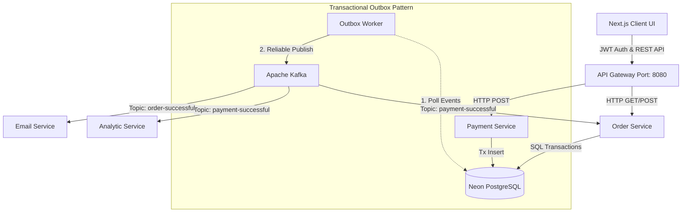

# 🛒 StreamMart: Enterprise Microservices Architecture

<div align="center">
  
  
  
  
  
</div>

## 📖 Overview
StreamMart is an enterprise-grade, event-driven e-commerce microservices architecture. It demonstrates modern backend patterns required for high-availability, fault-tolerant distributed systems. 

## 🏗️ Architecture & Workflow

The system is fully decoupled using **Apache Kafka** as the central message broker, allowing services to scale independently without bottlenecking synchronous HTTP chains.



## 🛠️ Technology Stack
- **Frontend**: Next.js 14, React, TailwindCSS
- **API Gateway**: Node.js, Express, `http-proxy-middleware`, JWT Authentication
- **Microservices**: Node.js (Order, Payment, Analytics, Email)
- **Message Broker**: Apache Kafka & Zookeeper
- **Database**: Neon (Serverless PostgreSQL)
- **ORM & Migrations**: Drizzle ORM
- **Containerization & DevOps**: Docker, Docker Compose, Kubernetes (`kubectl`)

## 💡 Key Design Decisions

### 1. Transactional Outbox Pattern (Reliability)
**The Problem:** If a service saves data to the database but fails to subsequently publish that event to Kafka (due to a network crash), the distributed system state becomes permanently inconsistent.
**The Solution:** The `payment-service` uses Drizzle ORM to **atomically** insert the payment record AND an event into a local `outbox_events` table in a single SQL transaction. A background worker then polls this table and reliably pushes events to Kafka, guaranteeing *at-least-once* delivery.

### 2. Drizzle ORM & Neon Postgres (Scalability vs Vendor Lock-In)
Using **Neon** provides seamless serverless database scaling on AWS infrastructure under the hood, while **Drizzle ORM** prevents vendor lock-in. By relying purely on standard SQL schemas and standard PostgreSQL configurations rather than proprietary SDKs, the persistence layer can be instantly ported to AWS RDS or GCP Cloud SQL if enterprise requirements pivot.

### 3. API Gateway & Centralized JWT Auth (Security)
Instead of exposing fragmented microservices directly to the front-end client (which creates security risks and CORS nightmares), a unified API Gateway acts as a reverse proxy. It intercepts requests, validates JSON Web Tokens (JWT), and securely routes traffic to internal cluster IPs, drastically reducing the attack surface area.

## 🚀 Getting Started Locally

### 1. Configure the Database
1. Create a free Serverless Postgres database on [Neon.tech](https://neon.tech).
2. Copy `.env.template` to `.env` and insert your Neon `DATABASE_URL`.
3. In both the `payment-service` and `order-service` directories, execute the migration:  
   ```bash
   npx drizzle-kit push
   ```

### 2. Spin Up the Cluster
Run the entire architecture at once securely using Docker Compose! Ensure Docker Desktop is running, then execute:
```bash
docker-compose up --build -d
```
Visit `http://localhost:3000` to interact with the Next.js frontend in real time!
